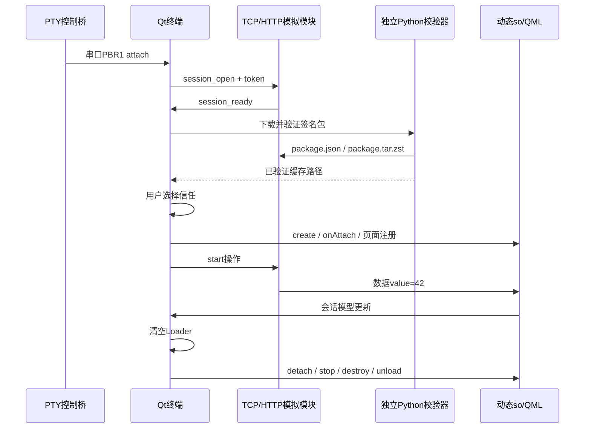

# 本机编译与调试

Material图标启动器、缩放动画、设备状态区、响应式、触屏与对比度验收见 `UI_ACCEPTANCE.md`。可用 `--window-size 800x480` 或 `--window-size 480x800` 体验不同屏幕；界面倍率在“设置”应用调整并保存。
主程序窗口最大化/最小化使用系统原生窗口控制；应用页使用固定工作区，任务栏负责多个应用任务切换，不提供应用内部拖动或贴靠操作。

## 目录

```text
scripts/setup-desktop.py    用户目录 SDK 安装
scripts/env.sh              CMake / Qt / Python 运行环境
scripts/build.sh            默认 Debug，支持 BUILD_DIR、JOBS、OPI_QT_ROOT
scripts/run-desktop.sh      模拟服务与 GUI 的共同生命周期
scripts/test.sh             编译及全部 CTest，保存 JUnit 结果
tools/desktop_demo.py       生成本机架构插件、签名和运行配置
tools/mock_bridge.py        Linux PTY + PBR1 串口接入模拟
tools/mock_module.py        TCP 设备和 HTTP 插件服务
src/core/                  状态机、传输协调、插件、卡片和页面模型
modules/example/           独立插件及两个 QML 页面
```

## 环境和编译

本机已验证 Pop!_OS 22.04 / x86_64 / GCC 11.4 / Qt 6.5.3。

```bash
python3 scripts/setup-desktop.py
bash scripts/build.sh
```

安装器仅写 `~/.local/share/orange-pi-terminal-sdk/`，通过用户 Python venv 安装 CMake、aqtinstall、cryptography，再安装 Qt。系统仍需已有 C++ 编译器、Python venv 支持、OpenGL/X11 运行库、zstd；这些在本机已存在。无显示环境下 GUI 测试使用 `xvfb-run`，本机已具备。

原生香橙派构建使用目标系统 Qt；设置 `OPI_QT_ROOT` 可覆盖桌面 SDK。不要将 x86_64 Qt 动态库复制到 ARM 板运行。交叉编译脚本另见技术规格，需要实际目标镜像 sysroot 与匹配版本 Qt host tools。

## 日常交互调试

```bash
bash scripts/run-desktop.sh
```

链路如下，不是静态界面演示：



操作：

1. 接入后确认权限；“始终信任”只信任相同公钥和清单，修改权限/版本后会再次询问。
2. 直接点主页模块功能图标，缩放展开插件页面；“开始”真实发送 TCP 数据，显示 42。
3. “数据诊断”切换插件第二个页面，查看独立会话模型。
4. “连接管理”中的“拔出触点”不终止无线数据；“插入示例”恢复触点。
5. “模拟断线”关闭设备端 socket，约 3 秒后自动重新认证；插件与页面保留。
6. 功能页“模块断开”通过数据链路请求并接收 ACK；“连接管理”中的“结束会话”从终端主动断开。关闭应用页本身只返回主页，不断开会话。
7. 断开后可在“连接管理”再次“插入示例”；缓存仍需重新验证文件完整性。新功能入口自动注册到主页。

桌面调试按钮通过 `--demo` 开启；首次启动的接入事件则通过 PTY 走实际串口解析器。

## GDB / IDE

终端 A 启动服务，不启动 GUI：

```bash
bash scripts/run-desktop.sh --serve-only
```

终端 B（同一工程目录）：

```bash
source scripts/env.sh
gdb --args build/orange_pi_terminal --config "$PWD/.desktop/product.json" --demo
```

GDB 中：

```text
break ConnectionManager::attach
break ModuleManager::load
set breakpoint pending on
break pi_module_on_data
run
continue
```

服务保持运行期间，配置中的随机端口有效；重启服务后请使用新生成的配置。服务独立运行时 GUI 的 `--demo` 在进程启动后产生接入事件，方便在断点处暂停，不依赖启动前的串口时序。

Qt Creator/CLion 打开本目录 `CMakeLists.txt`。选择 GCC、Debug，将 Qt 路径设为 `~/.local/share/orange-pi-terminal-sdk/qt/6.5.3/gcc_64`，CMake 使用 `~/.local/share/orange-pi-terminal-sdk/tools/bin/cmake`。运行参数同上；先独立启动 `--serve-only`。

可选 preset（使用独立的 build-preset，避免与默认 Makefiles 缓存冲突）：

```bash
source scripts/env.sh
cmake --preset desktop-debug
cmake --build --preset desktop-debug
ctest --preset desktop-debug
BUILD_DIR="$PWD/build-preset" bash scripts/run-desktop.sh
```

插件开发者可安装 SDK 到自己的目录：

```bash
source scripts/env.sh
cmake --install build --prefix "$HOME/.local/orange-pi-terminal"
```

外部插件使用 `find_package(OrangePiModuleSDK CONFIG REQUIRED)` 和 `target_link_libraries(your_module PRIVATE OrangePi::ModuleSDK)`，再实现 `pi_module_api.h` 的全部符号。`IModulePlugin.h` 只是插件内部可选 C++ 接口，不跨 `.so` 边界传递 Qt 对象。示例清单须按目标架构生成，嵌入清单与外部 JSON 必须一致。

QML 入口可声明 `property var sessionModel: null`；宿主注入的 QObject 提供 `data` 属性，由插件 `emit_event` 的 JSON 更新。使用插件包内相对 QML 文件，不向全局永久注册插件拥有的 C++ 类型。HostServices 的旧无 context 发布接口保留为空，插件使用 `emit_event(context, ...)` 和清单 actions。

## 测试、截图、性能

```bash
bash scripts/test.sh
bash scripts/run-desktop.sh --ui-test --quit-after 9000 \
  --screenshot build/desktop-live.png --metrics build/desktop-metrics.json
```

`--ui-test` 会自动通过真实权限窗口的“仅本次”函数完成自动化流程，成功输出 `UI_TEST_PASS`；未完成时返回非零状态。帧指标是 Qt `frameSwapped` 事件统计，RSS 仅为主进程，不含独立 WebEngine 子进程。不能用桌面指标替代香橙派测试。

如需完整手工操作记录，可从“设置与日志”查看最近 200 条；磁盘日志位于 `~/.local/share/ModularTerminal/OrangePiTerminal/terminal.log`，约 1 MiB 轮转一次。文件程序从当前用户家目录开始，文本编辑上限 64 KiB，拒绝绝对路径、越界路径和外部软链接。

## 真机连接前需要补齐

- ESP32 Host 在真实 Pogo 握手确认后发送 PBR1，拔触点只发送 detach；不得代替终端维持业务会话。
- 功能模块实现本工程的 BLE GATT/TCP/签名包协议，原 ESP-NOW 业务帧不兼容。
- 用产品固定配置替换桌面 token、地址、UUID、发布者公钥，使用 ARM64 插件包。
- 提供目标系统镜像/sysroot，再执行交叉构建；实际检查显示、触控、蓝牙、UART 和 GPU。

以上是当前未完成的硬件/固件交付项，不应仅凭桌面模拟结果标记为完成。
