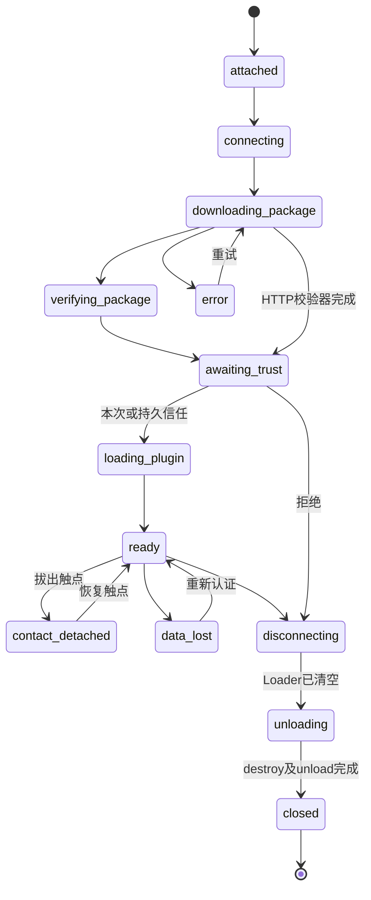

# Orange Pi Zero 3 动态模块终端：实现与验收规格

## 1. 架构和原始资料

原始依据为根目录 docs 下的 raspberry_pi_terminal_spec.md 与
raspberry_pi_esp32_migration.md。原始文件不修改，本目录是独立助手交付物。

保持 C++17、Qt6/QML、CMake、BlueZ/QtBluetooth、QtNetwork、纯 C ABI 插件。
ESP32 Host 执行 Pogo 唤醒与接入确认，通过 USB-UART/CDC 发送 PBR1；
终端直接与功能模块建立 BLE/LAN 会话。触点拔出不结束数据会话。


目录职责：src/core 管理会话和插件；src/transport 管理串口、GATT、TCP；
src/protocol 定义 CRC；src/ui 提供 FBO 模糊和系统工具；tools 提供签名包工具、
模拟模块；tests 提供 CTest/QtTest/集成测试；cmake 提供交叉工具链。

## 2. 板级适配

优先使用 USB 控制桥的 /dev/serial/by-id 路径。可选 UART5：26pin 8=PH2 TX，
10=PH3 RX，6/9/14/20/25=GND，3.3V TTL，TX/RX 交叉。
官方 Linux6.1 节点通常 /dev/ttyS5，5.4 通常 /dev/ttyAS5；用 orangepi-config
启用 ph-uart5，不同时启用复用的 ph-pwm12。
Micro HDMI 显示，USB 触控。Zero3 无树莓派 CSI/DSI 接口，IMX766 不能直接接入，
相机若需要接入应独立评估 USB/网络模块，不能声明原接口兼容。

用户提供手册 v1.6 第3.2节中，官方 Linux Mali GPU 标为 NO。
本机可执行 OpenGL/FBO 并不证明 Zero3 镜像能硬件加速；板端须记录 EGL/GL renderer、
驱动和帧率。保持 GPU mipmap/FBO 路线，未验证驱动前不宣称满足30fps。

## 3. 产品配置与发现

config/product.example.json 定义固定 module_id、transport_mode、BLE名称/UUID、
TCP地址/端口、包服务 URL、设备 token、发布者公钥和缓存路径。
这些配置必须在部署时预置，不能信任控制桥随意提供的下载地址。
当前 LAN 使用固定地址，模块应使用静态地址或 DHCP 保留租约。
最多8个会话；module_instance 限制为1–64个字母/数字/下划线/连字符。

三种模式：fixed_ble、fixed_hotspot_lan、fixed_ble_and_hotspot_lan。
双链路时 LAN 为主业务通道。大包使用 HTTP(S)；纯 BLE 自动采用认证数据链路的
`package_get/package_chunk` 小包传输。LAN 配置 `package_transport: "data"` 可测试相同分片逻辑。
小包限制1 MiB，HTTP(S)限制32 MiB。真实 BLE 空口尚未验收；本机测试通过 TCP 复用小包协议。
token 是受控 WPA2 局域网内的应用身份校验，不是独立防窃听协议。
跨不可信网络时需补 TLS 设备认证，不能将 CRC 当作认证。

## 4. PBR1 控制帧

魔数4字节，direction u8（0=终端到Host，1=Host到终端），kind u8（1事件、2命令、3错误），
sequence LE u32，length LE u16，payload UTF8 JSON，CRC16 LE。
CRC16/CCITT-FALSE：poly=0x1021，init=0xffff，覆盖 direction 至 payload。
payload≤2048；坏帧逐字节重新找魔数；接收缓冲上限16384；半帧1秒超时；串口每秒重试。

事件示例：

```json
{"event":"attach","module_id":128,"module_instance":"device-boot-42"}
```

detach 只更新 contact；数据链路决定终止会话。旧 ESP32 LinkIt 固件不会自动输出 PBR1。
当前交付不包含已完成并验证的 ESP32 控制桥改造，需在裁剪的 Host 固件握手成功回调中接入。

## 5. 数据帧和会话

TCP：BE u32 长度（包括 CRC trailer）+ JSON + LE CRC32，长度4–1048576。
CRC32/ISO-HDLC（标准向量123456789=0xcbf43926）；接收上限2MiB，半帧10秒超时。
BLE：LE u16 message_id/index/count，后接最多14字节分片。
完整重组结果为 JSON + LE CRC32，最大65536字节，乱序或超时清空。
发送以20字节GATT帧实现；支持 WriteWithResponse / WriteWithoutResponse 和通知订阅。

JSON 信封字段：version=1、module_id、module_instance、seq 单调递增、event。
data 使用 payload Base64，解码后交给插件；所有字段校验通过才刷新活跃时间。
session_open/session_ready 使用预置 token；每秒 ping/pong；6秒无有效数据触发重连，
3秒重试，30秒窗口结束后关闭。重连保留插件和界面，重新认证后恢复数据回调。

module_disconnect_request 允许 user_button/low_battery/fault/enter_sleep/reboot/maintenance。
策略允许时发送 stop、disconnect_ack(accepted=true)，关闭界面并释放插件；
拒绝时返回 accepted=false/reason=host_policy，继续会话。
终端主动断开发送 stop/session_close，等待 disconnect_ack；接受后才进入释放流程，拒绝则恢复会话，超时最多重试3次后执行本地安全关闭。生产协议仍需在真实固件上验证 ACK 顺序和幂等性。

### 5.1 Qt 状态机和页面生命周期

每个会话使用 `SessionStateMachine`（Qt State Machine Framework），非法跃迁不生效。
Host 的 attach 表示物理唤醒/识别已完成，终端不伪造尚未收到的 GPIO 唤醒状态。



图省略从各运行状态到 error/disconnecting 的公共路径。`ModuleCardModel` 用稳定实例行增量更新；
`PageProvider` 保存页面URL与宿主所有的 `SessionModel`，插件只发布值，不把插件 QObject 暴露给卡片。
`releasePage` 请求 unloading，状态机确认后才调用卸载，进入 closed 后移除卡片。

## 6. 插件包与签名

tools/package_tool.py 提供 keys/build/install；依赖 Python cryptography 和 zstd。
模块提供 package.json 和 package.tar.zst。package.json 包含 descriptor 和 Ed25519签名。
签名覆盖规范化 descriptor JSON（sort_keys、紧凑分隔符、UTF8），descriptor 包含
module_id、package_id、package_version、arch、abi_version、size、压缩包SHA256和每个文件SHA256。
签名位于包外，避免 manifest 中对自身包hash循环引用。

校验顺序：发布者公钥验证 → ID/架构/ABI/长度 → 下载压缩包 → SHA256 →
安全解包 → 文件集合/哈希/ELF架构/manifest → 原子重命名到 hash 缓存 → dlopen。
限制32MiB包和展开文件、1024文件；拒绝路径穿越、链接、特殊文件、重复文件和HTTP跳转。
缓存复用也重新核对文件哈希。整个校验进程60秒超时，失败不加载动态库。

### 6.1 BLE/数据链路小包

认证后由 `PackageReceiver` 逐块请求，JSON 信封字段仍遵循第5节。

```json
{"event":"package_get","transfer_id":"uuid","file":"package.json","offset":0,"length":512}
```

模块应答：

```json
{"event":"package_chunk","transfer_id":"uuid","file":"package.json","offset":0,"total":1234,"payload":"BASE64"}
```

只能请求 `package.json` 和 `package.tar.zst`；offset 是字节偏移，每块最多512字节。
接收器校验 transfer_id、文件名、严格连续偏移、总长度和 Base64；每块15秒超时，最多重试3次。
JSON清单上限256 KiB。先接收元数据，由独立 Python 进程验证发布者签名/模块ID/架构/ABI，
再按签名中的 size 请求压缩包（最多1 MiB），最后 `install-local` 重做全部校验并安装。
压缩包和元数据临时文件仅在对应会话中存活，关闭时删除。

首次加载弹出声明权限。持久信任键由发布者公钥内容和已验证 manifest 的 SHA256 构成，
更换权限或清单会重新询问。此信任是加载授权，不是进程沙箱。

## 7. 插件接口与卸载约束

src/modules/api/pi_module_api.h 是接口真源。保留原 v1 HostServices 前缀，
末尾追加 context-aware emit_event；插件使用它发布会话数据。
新增 pi_module_action 接收 manifest.actions 注册的操作。
主机校验所有必要符号，外部和嵌入 manifest 必须一致，qt_major=6，
unload_contract=synchronous-stop-v1，host_arch 与当前CPU一致。
示例 manifest 在 CMake 配置时生成当前构建架构和 package_id，并生成同内容C++常量。
SDK可通过CMake安装导出 `OrangePi::ModuleSDK`；`IModulePlugin.h` 为插件内部可选接口。
`pi_module_on_disconnect_request` 会在策略判定后被调用，插件不能自行卸载。

所有 ABI 回调在宿主串行线程执行，插件不得阻塞该线程；自行建立worker的插件必须在 stop
中终止并 join，不得保留 HostServices 回调。QML页面使用普通文件资源，不注册永久全局C++类型。
断开时先禁用功能入口；若页面正在显示，完成200ms关闭缩放后清空Loader，事件循环下一轮releasePage，再detach/stop/destroy/unload。
普通关闭应用页只清空当前QML页面，保留模块数据会话；通过“连接管理”断开才释放插件。
退出时 QML engine 先于插件管理器析构。
此契约用于可信插件；主机无法证明恶意插件没有后台线程，进程内 .so 不提供安全隔离。

## 8. UI、浏览器和系统工具

QML主页采用Material应用图标网格，横向分页并保留轻微Z轴(0,0,1)倾斜，限制±30度。
接入模块直接在主页注册功能入口；连接管理只显示状态、进度、重试和断开，业务页面在独立应用层。
应用展开260ms、关闭200ms；状态区参考用户“学习样式.jpg”，提供主页、最近应用、真实通知、网络、蓝牙、电源和时间。
正文至少18pt、标题至少24pt、主要按钮默认64逻辑像素、主要间隔至少16；短屏、竖屏和高DPI自适应，设置可放大至150%。
已对内置配色计算对比度，最低6.081:1；运行时布局与触摸事件测试见UI_ACCEPTANCE.md，板端仍需实际显示/触控验收。
背景 BlurItem 使用 QQuickFramebufferObject、四级1/2降采样到1/16、加权滤波上采样混合。
该实现为降采样模糊近似。背景使用四级金字塔；应用图标使用一级浅金字塔与原图混合（模糊10%、原图90%），文字不参与模糊。
浏览器为 QtWebEngine，最多4标签、书签、1–3倍放大。
文件管理以当前用户家目录为起始路径，支持创建目录、UTF8文本保存、重命名及删除文件；输入仍拒绝绝对路径、路径穿越和软链接越界。
拒绝越界路径和外部软链接，编辑最多64KiB；非UTF8/二进制/大文件不允许文本覆盖。
系统工具显示网卡地址、200条内存日志、约1MiB轮转磁盘日志、热点启停和持久TTS开关。
TTS取决于系统语音插件。主题使用Material图标风格，33个Google Material Icons Round字形离线打包，许可和来源哈希随工程分发。
设备面板通过QNetworkInterface、QtBluetooth、Linux power_supply/meminfo和QStorageInfo读取实际状态；缺少电池/适配器时标明未检测到，不伪造照片中的LTE、电量或通知数。


## 9. 构建部署

Debian12/Ubuntu24.04板级镜像，Qt≥6.4；原手册install_qt.sh安装Qt5，不适用。
依赖 Qt Core/Network/Bluetooth/SerialPort/Qml/Quick/QuickControls2/OpenGL/WebEngineQuick/TextToSpeech/Test/StateMachine。
Debian包通常为 qt6-base-dev、qt6-declarative-dev、qt6-connectivity-dev、
qt6-serialport-dev、qt6-webengine-dev、qt6-speech-dev、python3-cryptography、zstd。
还需要 Qt StateMachine 开发模块，以及相应 qml6-module-* 运行包。本机通过 setup-desktop.py 安装完整 Qt SDK。
构建（详细命令见 DESKTOP_DEBUG.md）：

```bash
bash scripts/build.sh
source scripts/env.sh
ctest --test-dir build --output-on-failure
bash scripts/run-desktop.sh
```

原生安装前缀/usr：`sudo cmake --install build`。
用户服务配置 `ExecStart=/usr/bin/orange_pi_terminal --config /etc/orange-pi-terminal/product.json`，
在图形会话中 `systemctl --user import-environment DISPLAY WAYLAND_DISPLAY XAUTHORITY`，
然后 `systemctl --user start orange-pi-terminal`。运行用户需串口dialout权限和缓存目录写权限。
桌面启动环境差异需要目标系统验证；没有强制EGLFS。

热点：在本地/有线管理连接下显式执行 `bash scripts/configure-hotspot.sh`（多网卡时传入无线接口名称），
创建2.4GHz、信道6、PI_MODULE_NET、192.168.50.1/24的NetworkManager shared连接。
使用 Linux NetworkManager 提供的 WPA2 认证和共享模式 DHCP；会提示输入WPA2密钥，不自动启动。程序通过nmcli启停该预配置连接；
不要同时用create_ap管理同一无线接口。当前电脑测试没有改变现用网络配置。

交叉编译：设置OPI_SYSROOT（包含目标Qt头/库）、QT_HOST_PATH（同版本主机Qt工具），
安装aarch64-linux-gnu工具链后执行scripts/build-cross.sh；sysroot必须来自最终目标镜像。
尚未提供真实板端sysroot，因此交叉链接未验证。

## 10. 验证与未完成项

本机 Qt6.5.3/GCC11 Debug 编译，PBR1、QtTest生命周期/会话、数据链路分片包、信任门控、
状态机/模型/文件边界、签名包篡改、Xvfb GUI和实际桌面操作已验证。GDB可命中源码断点。
`--metrics` 保存帧事件率、P95事件间隔和主进程RSS；不是GPU耗时或整机内存泄漏结论。

未完成：完整ESP32 PBR1/BLE/LAN固件适配和烧录、目标ARM64 sysroot/交叉链接、真实BLE/串口/触控验收、
板端GPU/30fps测量、长时运行和完整内存泄漏分析、可靠关闭ACK重传机制及不可信网络TLS设备认证。
本次实现的是可持续本机调试的终端与模拟模块，不能把上述硬件/固件工作描述为已经完成。

## 11. 当前符合性状态（2026-10-01）

本表是代码审查结论；“通过”仅表示列出的本机实现/自动测试通过，不代表目标板验收。

| 规范要求 | 当前状态 | 证据/限制 |
|---|---|---|
| C++17、Qt6、CMake；PBR1 CRC/重新同步/有界串口缓冲 | 本机通过 | `scripts/test.sh` 六组通过；尚无真实 Host 固件联调 |
| 签名包校验、路径与 ELF 限制、ABI/manifest 检查 | 本机通过，安全边界有限 | Python 独立校验器和集成测试；插件仍在宿主进程运行，不是沙箱 |
| Qt 页面清空后再卸载插件、模块会话保留 | 本机模拟通过 | UI集成测试覆盖动画后断开；退出时依赖 QObject 析构顺序，未做长时/故障注入验证 |
| 固定工作区、任务栏切换、内部应用窗口控制 | 部分符合 | 应用表面自身最大化/最小化且Qt主窗口保持不变；`openTasks` 是记录列表，只有一个前台页面 Loader，不是每任务独立保存 QML 页面状态 |
| BLE GATT、TCP 帧、重连和会话认证 | 部分实现，未实机验收 | 有客户端代码和 TCP/小包模拟；未验证真实模块、BlueZ 特征属性、AP/STA共存和无线重连 |
| 主动断开请求及 ACK | 本机实现通过，真实协议待验收 | 主动关闭等待 `disconnect_ack`，有限重试；模块主动请求先回复 ACK，再等待 `session_close`，超时安全关闭。仍需真实固件验证 ACK 顺序、重复帧和幂等性 |
| 文件程序以当前用户家目录为起点 | 本机通过 | 根目录为 `QDir::homePath()`；边界及软链接测试在 runtime_test |
| TTS 持久设置与关键操作播报 | 部分实现 | TTS API/开关存在，连接状态 announcement 接入；QML 常见关键按钮未逐项播报，受系统语音引擎影响 |
| 通知、蓝牙/网络/电池/存储状态 | 部分实现 | 基于桌面系统 API 读取；蓝牙错误会记录到通知/日志，热点仅操作预配置 NetworkManager profile |
| GPU模糊、Material图标、字号和触控布局 | 桌面实现通过，板端未知 | Xvfb/DPI审计与颜色检查通过；不能证明 Orange Pi GPU、真实触屏或 30fps |
| QtWebEngine标签/书签/缩放 | 部分实现 | 最多4个标签、书签和缩放控件；自动化链接目标使用外部URL，不是完全离线确定性验证 |
| ARM64交叉构建、部署启动、长期稳定性 | 未验证 | 无最终镜像 sysroot、板端硬件和长期压力/泄漏测试 |

因此，当前工程是**可在本机调试且部分符合规范的原型**，不是已经完全符合全部技术规范的板端产品。全量 CTest 通过只能支撑本表标明的桌面测试项。
